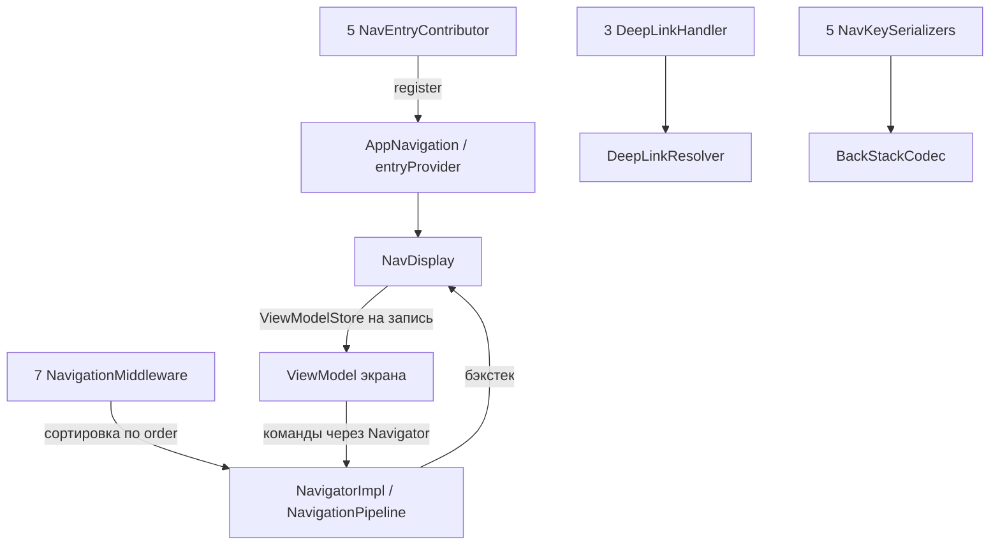

# DI-архитектура NavPlayground

Схемы используют одинаковые уровни: объявления → сборка зависимостей → точки входа → ViewModel.
Стрелки подписаны действием: регистрация, создание, получение или передача зависимости.
Это логические схемы приложения, а не полный перечень внутренних компонентов фреймворков.

| Схема | Статус | Исходная точка |
|---|---|---|
| [Hilt](hilt.md) | Реализован | `di/hilt`, `a028ebe` |
| [Metro](metro.md) | Реализован, сборка и 91 тест проходят | `di/metro`, миграция `3e140eb` |
| [Koin](koin.md) | Реализован, сборка и 93 теста проходят | `di/koin`, Classic DSL 4.2.2 |

## Что должно оставаться одинаковым

Числа относятся к текущим четырём фичам и app-заглушке; это не требования фреймворка.
Обработчика deep link для media нет. У auth есть дополнительный middleware.
Список middleware: logging, throttling, deep link validation/resolution, feature flags, auth, analytics.

| Время жизни | Hilt | Metro | Koin |
|---|---|---|---|
| Граф приложения | SingletonComponent | Один AppGraph в PlaygroundApp | startKoin один раз из Application |
| Общие объекты | `@Singleton` | `@SingleIn(AppScope::class)` | `single` |
| ViewModel | Hilt factory + ViewModelStore | Metro factory + ViewModelStore | Koin factory + ViewModelStore |
| Сбор вкладов фич | `@IntoSet` | `@ContributesTo` + `@IntoSet` | Именованные определения + getAll |
| Проверка графа | Dagger/Hilt при сборке | Metro compiler plugin | Тесты runtime-контейнера; без compiler plugin |

Общие объекты: навигатор, SessionManager, feature flags, лог, аналитика, resolver, кодек и coroutine scope.
Stateful throttling тоже имеет одну общую инстанцию. Установка модуля в app scope не делает все его
объекты singleton автоматически. ViewModel не должны становиться singleton приложения.

`NavigationScope` — qualifier для CoroutineScope, не область DI (аннотация у Hilt/Metro,
значение `named("navigation.coroutines")` у Koin). Аргументы маршрутов
передаются из NavKey в экран обычными параметрами. Порядок middleware задаёт `order`.

Схемы обновляются вместе с кодом. Статус миграций и результаты проверок хранятся в
[WORK_CONTEXT.md](../WORK_CONTEXT.md), правила работы — в [AGENTS.md](../../AGENTS.md).
