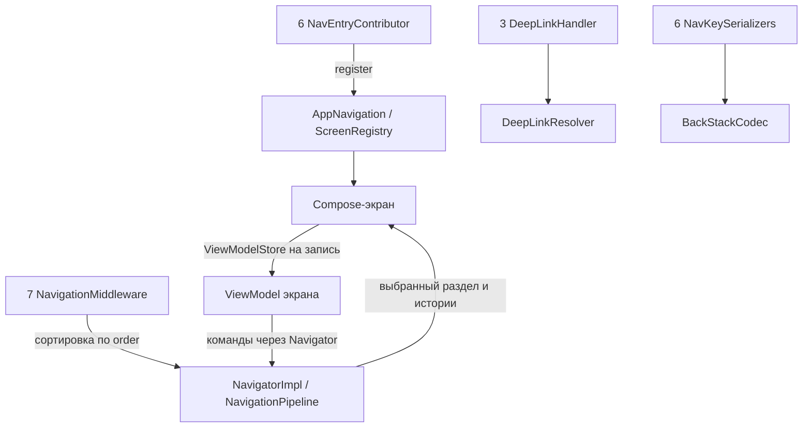

# DI-архитектура NavPlayground

Схемы используют одинаковые уровни: объявления → сборка зависимостей → точки входа → ViewModel.
Стрелки подписаны действием: регистрация, создание, получение или передача зависимости.
Это логические схемы приложения, а не полный перечень внутренних компонентов фреймворков.

| Схема | Статус | Исходная точка |
|---|---|---|
| [Manual](manual.md) | Реализован | `main`, AppContainer |
| [Manual + Decompose](../navigation.md) | Текущая ветка | `decompose/manual`, AppContainer |
| [Hilt](hilt.md) | Реализован | `di/hilt`, `a028ebe` |
| [Dagger 2](dagger.md) | Реализован | `di/dagger`, явный AppComponent |
| [Metro](metro.md) | Реализован | `di/metro`, миграция `3e140eb` |
| [Koin](koin.md) | Реализован | `di/koin`, Classic DSL 4.2.2 |

Подробная [архитектура навигации](../navigation.md) показывает поток команд, middleware,
deep links, результаты, разделы и восстановление состояния. Сборки и тесты описаны в [WORK_CONTEXT](../WORK_CONTEXT.md).

## Что должно оставаться одинаковым

Пять фич и app-заглушка вносят экраны и сериализаторы. Requests регистрирует список и карточку
одним contributor и сериализаторы обоих ключей одним вкладом. У Requests пока нет ViewModel и deep link.
У auth есть дополнительный middleware.
Список middleware: logging, throttling, deep link validation/resolution, feature flags, auth, analytics.

| Время жизни | Manual / main | Hilt | Dagger 2 | Metro | Koin |
|---|---|---|---|---|---|
| Граф приложения | AppContainer в Application | SingletonComponent | AppComponent в Application | AppGraph в Application | startKoin один раз |
| Общие объекты | Ссылки в `val` контейнера | `@Singleton` | `@Singleton` в AppComponent | `@SingleIn(AppScope::class)` | `single` |
| ViewModel | Manual factory + ViewModelStore | Hilt factory + ViewModelStore | Карта Provider + ViewModelStore | Metro factory + ViewModelStore | Koin factory + ViewModelStore |
| Сбор вкладов | Явные `setOf` в AppContainer | `@IntoSet` | `@IntoSet` в модулях AppComponent | `@ContributesTo` + `@IntoSet` | Qualifiers + getAll |
| Проверка связей | Kotlin-вызовы конструкторов и тесты регистраций | Dagger/Hilt при сборке | Dagger + KSP при сборке | Metro compiler plugin | Тесты runtime-контейнера |

Общие объекты: навигатор, SessionManager, feature flags, лог, аналитика, resolver, кодек и coroutine scope.
Stateful throttling тоже имеет одну общую инстанцию. Установка модуля в app scope не делает все его
объекты singleton автоматически. ViewModel не должны становиться singleton приложения.

`NavigationScope` — qualifier для CoroutineScope, не область DI (аннотация у Hilt, Dagger и Metro,
значение `named("navigation.coroutines")` у Koin). В manual DI qualifier отсутствует:
контейнер передаёт нужный CoroutineScope напрямую. Аргументы маршрутов
передаются из NavKey в экран обычными параметрами. Порядок middleware задаёт `order`.

Схемы обновляются вместе с кодом. Статус миграций и результаты проверок хранятся в
[WORK_CONTEXT.md](../WORK_CONTEXT.md), правила работы — в [AGENTS.md](../../AGENTS.md).
