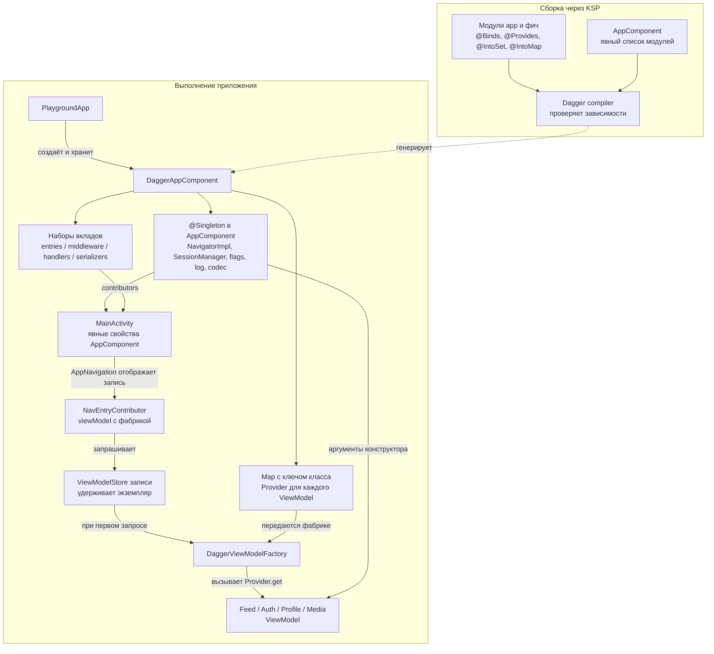

# Dagger 2 — реализация в di/dagger

Ветка `di/dagger` создана от `di/hilt`. Версии Dagger 2.60.1 и KSP 2.3.11 соответствуют базе миграции.

## Кто собирает граф

`AppComponent` явно перечисляет модули, поэтому состав сборки виден в одном месте. Фичи объявляют
свои вклады через `@IntoSet`. `@Binds` связывает `Navigator` с экземпляром `NavigatorImpl`,
который использует и Activity. `Application` хранит один компонент, поэтому его `@Singleton`-объекты
переживают поворот. Новый экземпляр компонента получил бы собственные сессию и навигатор.

## Кто владеет ViewModel

Модуль каждой фичи с ViewModel объявляет привязку через `@IntoMap` и `@ClassKey`.
Dagger собирает из этих привязок карту провайдеров. Фабрика вызывает
`Provider.get()` только когда AndroidX запрашивает экземпляр. Contributor вызывает `viewModel()`
внутри контента записи, где декоратор Navigation 3 уже предоставил её `ViewModelStoreOwner`.
Поэтому два профиля используют одну сессию приложения, а их ViewModel принадлежат двум разным записям.
Идентификатор профиля, как и раньше, приходит в экран из NavKey.

Для сравнения Hilt сам создаёт Android-компоненты и предоставляет фабрику ViewModel. Здесь список модулей,
создание компонента и подключение фабрики видны в исходниках приложения. Тест графа проверяет все ключи
экранов и сериализаторы, потому что отсутствующий вклад в набор может оставить граф формально валидным.
[Компоненты Hilt](https://dagger.dev/hilt/components.html) · [Мультибиндинги Dagger](https://dagger.dev/dev-guide/multibindings.html)

## Исходники

- [AppComponent](https://github.com/akma302/NavPlayground/blob/1da7528/app/src/main/kotlin/dev/navplay/app/di/AppComponent.kt)
- [PlaygroundApp](https://github.com/akma302/NavPlayground/blob/1da7528/app/src/main/kotlin/dev/navplay/app/PlaygroundApp.kt)
- [MainActivity](https://github.com/akma302/NavPlayground/blob/1da7528/app/src/main/kotlin/dev/navplay/app/MainActivity.kt)
- [DaggerViewModelFactory](https://github.com/akma302/NavPlayground/blob/1da7528/app/src/main/kotlin/dev/navplay/app/di/DaggerViewModelFactory.kt)
- [Вклад Feed](https://github.com/akma302/NavPlayground/blob/1da7528/feature/feed/impl/src/main/kotlin/dev/navplay/feature/feed/impl/FeedNavigationModule.kt)
- [NavigationGraphTest](https://github.com/akma302/NavPlayground/blob/1da7528/app/src/test/kotlin/dev/navplay/app/navigation/NavigationGraphTest.kt)

[Атлас DI](README.md) · [Навигация](../navigation.md) · [Результаты проверок](../WORK_CONTEXT.md#проверки)
