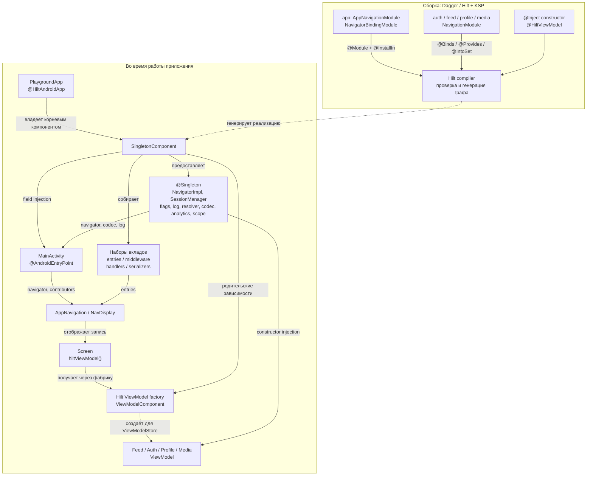

# Hilt — исходная реализация

**Реализовано в `di/hilt`, исходный коммит `a028ebe`.**
Схема привязана к исходному Hilt-коду. В main теперь отдельная реализация manual DI.

Hilt управляет Android-точками входа: Application запускает корневой компонент, Activity получает
поля через injection. ViewModel запрашивают интерфейс Navigator; Activity получает NavigatorImpl
для работы с бэкстеком. `@Binds` связывает их с одним экземпляром.

Фичи сами вносят экран, сериализатор и, где предусмотрено, deep link handler и auth middleware.
Граф собирает четыре набора; их потребители показаны на [общей схеме](README.md).
Полная иерархия Hilt-компонентов, включая ActivityRetainedComponent, здесь опущена.

Время жизни ViewModel определяется ViewModelStore записи NavDisplay:
`rememberViewModelStoreNavEntryDecorator`, а не SingletonComponent.

## Привязка к исходникам

- [Application и Hilt entry point](https://github.com/akma302/NavPlayground/blob/a028ebe/app/src/main/kotlin/dev/navplay/app/PlaygroundApp.kt)
- [MainActivity: field injection](https://github.com/akma302/NavPlayground/blob/a028ebe/app/src/main/kotlin/dev/navplay/app/MainActivity.kt)
- [Инфраструктура и общие зависимости](https://github.com/akma302/NavPlayground/blob/a028ebe/app/src/main/kotlin/dev/navplay/app/di/AppNavigationModule.kt)
- [Auth: session binding и вклады фичи](https://github.com/akma302/NavPlayground/blob/a028ebe/feature/auth/impl/src/main/kotlin/dev/navplay/feature/auth/impl/AuthNavigationModule.kt)
- [ViewModelStore на запись навигации](https://github.com/akma302/NavPlayground/blob/a028ebe/app/src/main/kotlin/dev/navplay/app/navigation/AppNavigation.kt)

[Сравнение реализаций](README.md)

[Архитектура навигации: от команды до экрана](../navigation.md)
