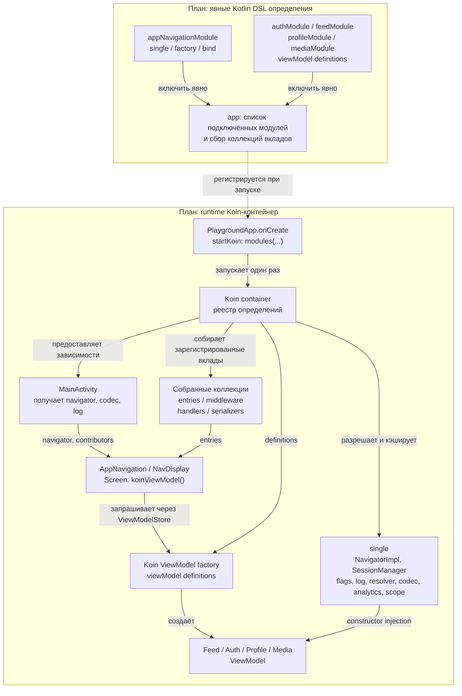

# Koin — предлагаемая архитектура

**ПЛАН, НЕ РЕАЛИЗОВАНО.** В `di/koin` пока находится исходный Hilt-код (`a028ebe`).
Схема показывает возможную миграцию на Classic Kotlin DSL; выбор версии и compiler plugin ещё предстоит.

Предлагаемый подход: сохранить обычные конструкторы ViewModel, описать providers в DSL-модулях фич,
а список модулей подключить в `app`. Hilt `@IntoSet` не переносится автоматически:
нужно явно организовать сбор вкладов, например через отдельные concrete definitions,
привязанные к общему интерфейсу, и `getAll<T>()` с преобразованием в нужную коллекцию.
Детали регистрации и отсутствие потерь/коллизий должны проверяться тестами миграции.

Navigator и NavigatorImpl должны ссылаться на одну single-definition; аналогично FeatureFlags
и MutableFeatureFlags. Нельзя создавать два независимых singleton для интерфейса и реализации.

`viewModel`-definition управляет созданием, а ViewModelStore записи NavDisplay — временем жизни.
ViewModel нельзя объявлять через `single`. Общие объекты приложения остаются single.

При использовании Classic DSL без compiler plugin отсутствующая зависимость может обнаружиться
при первом разрешении. Koin поддерживает отдельный compiler plugin с проверками графа;
его использование здесь пока не согласовано и схема не предполагает, что Koin лишён этой возможности.

## Критерии готовности миграции

- Удалены Hilt/KSP и старые точки входа; Koin стартует один раз из Application.
- Сохранены все 5 entries, 7 middleware, 3 handlers и 5 serializer contributions.
- Все четыре ViewModel создаются, разделены по записям и используют общую сессию/навигатор.
- Пройдены assembleDebug и JVM-тесты, включая реальную сборку Koin-модулей.
- После внедрения эта схема сверена с кодом и пометка «план» удалена.

[Koin DSL](https://insert-koin.io/docs/reference/koin-core/dsl/) ·
[Koin Compose](https://insert-koin.io/docs/reference/koin-compose/compose/) ·
[Compile-time checks](https://insert-koin.io/docs/reference/koin-compiler/compile-safety/) ·
[Сравнение реализаций](README.md)
