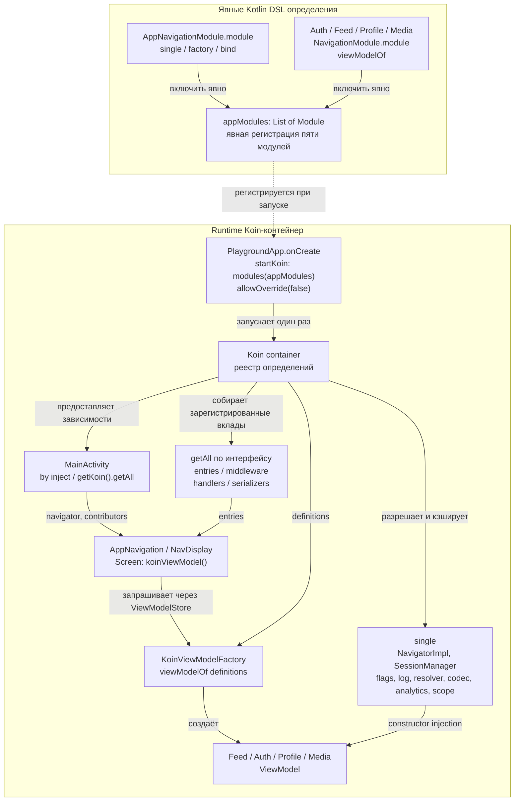

# Koin — реализация в di/koin

**Реализовано в `di/koin`: Koin 4.2.2, Classic Kotlin DSL, без compiler plugin.**
Hilt/KSP удалены. Чистая сборка и 93 JVM-теста проходят.

Обычные конструкторы ViewModel не зависят от Koin. Каждая фича экспортирует
`NavigationModule.module`, а `appModules` явно подключает инфраструктуру и четыре фичи.
`PlaygroundApp.onCreate` запускает Koin один раз; Activity использует `by inject()`
и `getKoin().getAll<NavEntryContributor>().toSet()`.

## Коллекции и общие объекты

Вклады регистрируются непосредственно под интерфейсом с уникальными qualifiers:
`factory<NavEntryContributor>(named("auth.entries"))`,
`factory<NavigationMiddleware>(named("auth.guard"))` и т. п.
`getAll<T>()` собирает все qualified definitions этого типа. `allowOverride(false)`
запрещает случайно заменить одноимённое определение. Не используются несколько неименованных
`bind` одного интерфейса: в строгом режиме это конфликт.

Четыре generic Set не регистрируются как самостоятельные неименованные definitions:
Koin стирает generic arguments. Коллекции собираются непосредственно у потребителя:
NavigatorImpl получает middleware, DeepLinkResolver — handlers, BackStackCodec — serializers.
Порядок middleware по-прежнему задаёт `order`.

NavigatorImpl зарегистрирован как single и через `bind` доступен как Navigator;
аналогично MutableFeatureFlags → FeatureFlags. Интерфейс и реализация возвращают один объект.
SessionManager, лог, аналитика, resolver, кодек, throttling и coroutine scope тоже single.
`NavigationScope` — значение qualifier `named("navigation.coroutines")`.
Callback `onClose` отменяет CoroutineScope при явном закрытии контейнера (например, в тестах).

## ViewModel и проверка графа

`viewModelOf(::FeedViewModel)` и аналогичные определения используются KoinViewModelFactory;
экраны запрашивают `koinViewModel()` из `org.koin.compose.viewmodel`.
ViewModelStore текущей записи NavDisplay сохраняет экземпляр и очищает его при удалении записи;
две записи получают разные ViewModel с общей сессией. ViewModel не объявлены как single.

Выбран Classic DSL без compiler plugin: ошибки разрешения зависимостей выявляются при выполнении.
Koin поддерживает отдельный compiler plugin; в этой реализации он намеренно не подключён.
`KoinGraphTest` поднимает те же `appModules` в изолированном контейнере со строгими overrides,
проверяет общие экземпляры, все 5 entries, 7 middleware, 3 handlers и 5 serializer contributions,
фабрику всех четырёх ViewModel и разделение ViewModelStore, auth/feature flags,
отмену coroutine scope при закрытии и свежие single-объекты нового контейнера.

## Привязка к исходникам

- [Запуск Koin](https://github.com/akma302/NavPlayground/blob/di/koin/app/src/main/kotlin/dev/navplay/app/PlaygroundApp.kt)
- [Список appModules](https://github.com/akma302/NavPlayground/blob/di/koin/app/src/main/kotlin/dev/navplay/app/di/AppModules.kt)
- [Общая инфраструктура](https://github.com/akma302/NavPlayground/blob/di/koin/app/src/main/kotlin/dev/navplay/app/di/AppNavigationModule.kt)
- [Пример фичи auth](https://github.com/akma302/NavPlayground/blob/di/koin/feature/auth/impl/src/main/kotlin/dev/navplay/feature/auth/impl/AuthNavigationModule.kt)
- [Получение зависимостей Activity](https://github.com/akma302/NavPlayground/blob/di/koin/app/src/main/kotlin/dev/navplay/app/MainActivity.kt)
- [KoinGraphTest](https://github.com/akma302/NavPlayground/blob/di/koin/app/src/test/kotlin/dev/navplay/app/di/KoinGraphTest.kt)

[Koin DSL](https://insert-koin.io/docs/reference/koin-core/dsl/) ·
[Koin Compose](https://insert-koin.io/docs/reference/koin-compose/compose/) ·
[Сравнение реализаций](README.md)
