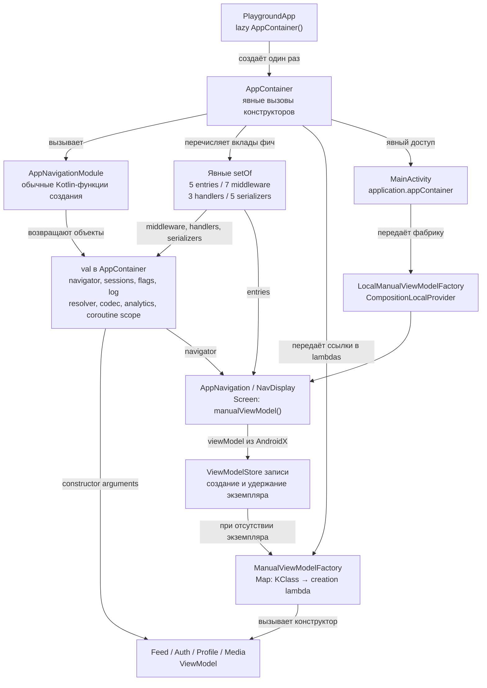

# Manual DI — реализация в main

**Реализовано в `main`: обычный Kotlin, без DI-фреймворка и генерации графа.**

Application хранит один AppContainer на процесс. Общие зависимости являются обычными `val`:
один и тот же NavigatorImpl передаётся всем ViewModel как Navigator, одна SessionManager —
auth/profile/feed и auth middleware. Кеширования по аннотациям и поиска в runtime-реестре нет.

AppNavigationModule — имя обычного объекта с Kotlin-функциями. В нём нет `@Module` или DI DSL;
сам он не определяет время жизни объектов. AppContainer вызывает helpers один раз и хранит результат.
Порядок и состав графа видны в коде; создание навигатора происходит после его middleware.

Фичи предоставляют классы contributors/handlers и helpers сериализации. Новую фичу нужно явно
добавить в соответствующие `setOf` и в карту фабрик ViewModel в AppContainer.
Здесь нет автоматического обнаружения вкладов по classpath.

## ViewModel и время жизни

`core:di` содержит ManualViewModelFactory и Compose helper, а не контейнер фич.
MainActivity передаёт фабрику через CompositionLocalProvider. `manualViewModel()` вызывает
стандартный AndroidX `viewModel(factory = ...)` с текущим ViewModelStoreOwner.
Его предоставляет `rememberViewModelStoreNavEntryDecorator` из Navigation 3.

Карта фабрики хранит функции создания. ViewModelStore удерживает экземпляры по записи бэкстека;
две записи могут иметь разные ProfileViewModel с общими app-level зависимостями.
Фабрика выбрасывает понятную ошибку, если ViewModel не зарегистрирована.
Текущие ViewModel не используют SavedStateHandle; автоматической инъекции аргументов и SavedStateHandle нет.

`AppContainer.close()` отменяет navigation CoroutineScope для явного владельца, например теста.
В Android контейнер живёт с Application; надёжный callback завершения процесса не предполагается.

## Проверки и исходники

ManualGraphTest создаёт настоящий AppContainer и проверяет все коллекции/сериализаторы,
создание четырёх ViewModel и их разделение/очистку по ViewModelStore, общую сессию и навигатор,
auth/feature flags, cleanup и ошибку отсутствующей регистрации.
Компилятор проверяет обычные вызовы конструкторов; полнота ручных регистраций проверяется тестами.

- [AppContainer](https://github.com/akma302/NavPlayground/blob/21d9b76/app/src/main/kotlin/dev/navplay/app/di/AppContainer.kt)
- [Application](https://github.com/akma302/NavPlayground/blob/21d9b76/app/src/main/kotlin/dev/navplay/app/PlaygroundApp.kt)
- [MainActivity](https://github.com/akma302/NavPlayground/blob/21d9b76/app/src/main/kotlin/dev/navplay/app/MainActivity.kt)
- [ManualViewModelFactory](https://github.com/akma302/NavPlayground/blob/21d9b76/core/di/src/main/kotlin/dev/navplay/core/di/ManualViewModelFactory.kt)
- [Compose helper](https://github.com/akma302/NavPlayground/blob/21d9b76/core/di/src/main/kotlin/dev/navplay/core/di/ManualViewModel.kt)
- [ManualGraphTest](https://github.com/akma302/NavPlayground/blob/21d9b76/app/src/test/kotlin/dev/navplay/app/di/ManualGraphTest.kt)

[Сравнение реализаций](README.md)

[Архитектура навигации: от команды до экрана](../navigation.md)
