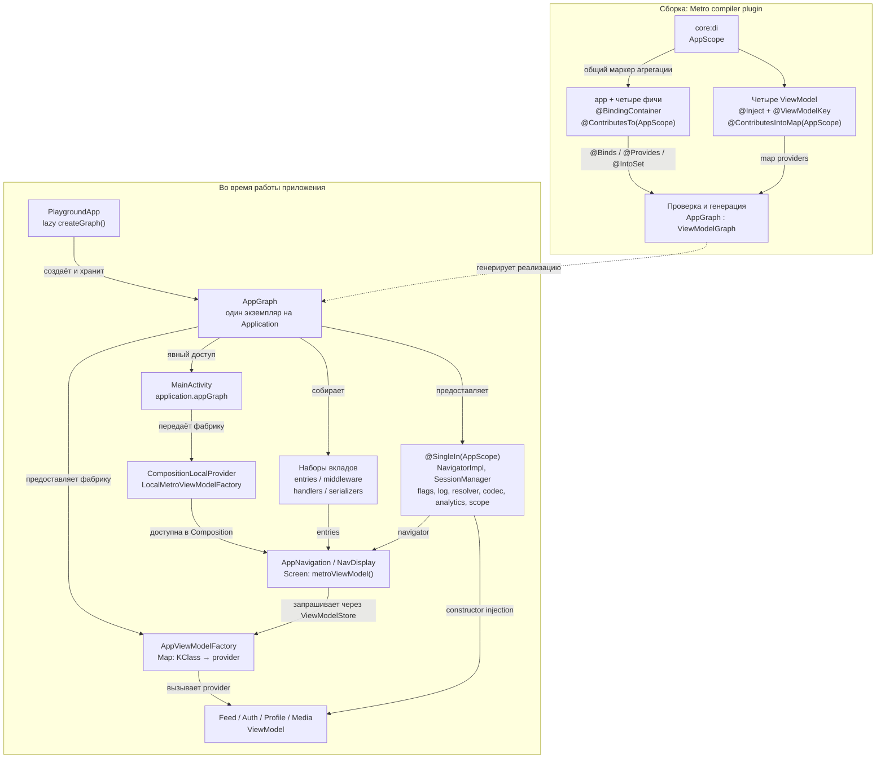

# Metro — текущая реализация

**Реализовано в `di/metro`, Metro 1.4.5, миграция `3e140eb`.**

Android создаёт обычные Application и Activity. Граф создаётся явно в Application;
MainActivity получает его через `application`, без Hilt-аннотаций и field injection.
Вклады фич автоматически обнаруживаются на classpath по общему AppScope.

AppViewModelFactory — singleton фабрика; создаваемые ею ViewModel не singleton.
`metroViewModel()` использует ViewModelStore текущей записи NavDisplay, поэтому две записи
могут иметь разные ProfileViewModel с общей SessionManager.

Набор ViewModel providers хранит функции создания, а не заранее созданные ViewModel.
MetroX также предоставляет карты assisted factories; сейчас приложение их не использует.

## Привязка к исходникам

- [AppScope](../../core/di/src/main/kotlin/dev/navplay/core/di/AppScope.kt)
- [AppGraph](../../app/src/main/kotlin/dev/navplay/app/di/AppGraph.kt)
- [Application: создание графа](../../app/src/main/kotlin/dev/navplay/app/PlaygroundApp.kt)
- [MainActivity: передача фабрики в Compose](../../app/src/main/kotlin/dev/navplay/app/MainActivity.kt)
- [Навигационные привязки и providers](../../app/src/main/kotlin/dev/navplay/app/di/AppNavigationModule.kt)
- [AppViewModelFactory](../../app/src/main/kotlin/dev/navplay/app/di/AppViewModelFactory.kt)
- [Пример ViewModel](../../feature/feed/impl/src/main/kotlin/dev/navplay/feature/feed/impl/FeedViewModel.kt)
- [MetroGraphTest](../../app/src/test/kotlin/dev/navplay/app/di/MetroGraphTest.kt)

Для версии 1.4.5 Compose API находятся в `dev.zacsweers.metrox.viewmodel` без `.compose`.
Scope ставится на injected class/provider, а не на `@Binds`.

[Документация Metro](https://zacsweers.github.io/metro/latest/) · [Сравнение реализаций](README.md)
