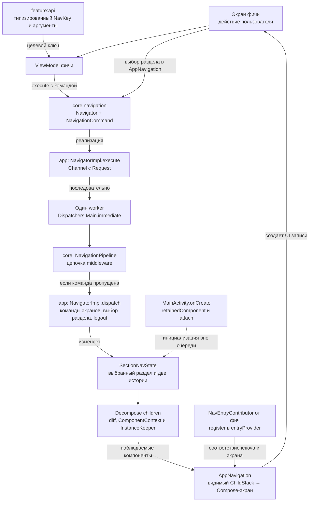
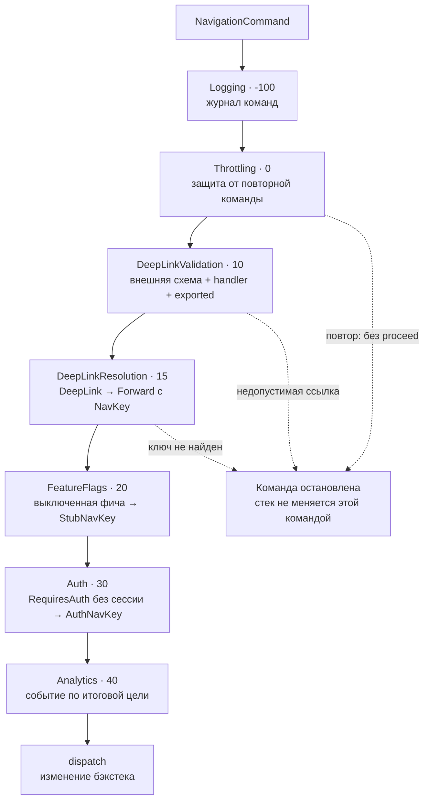
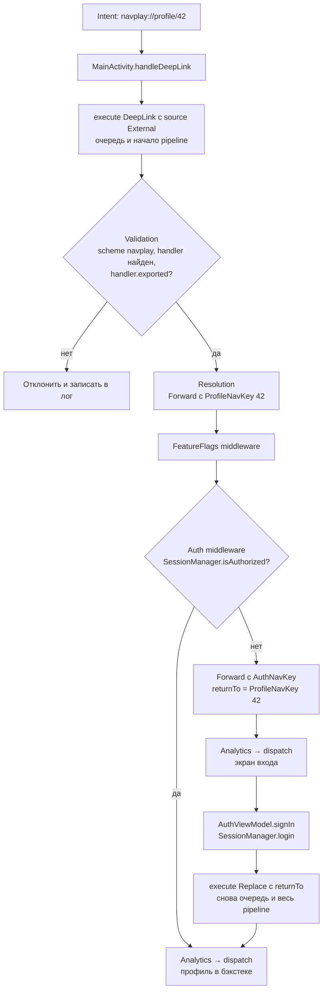
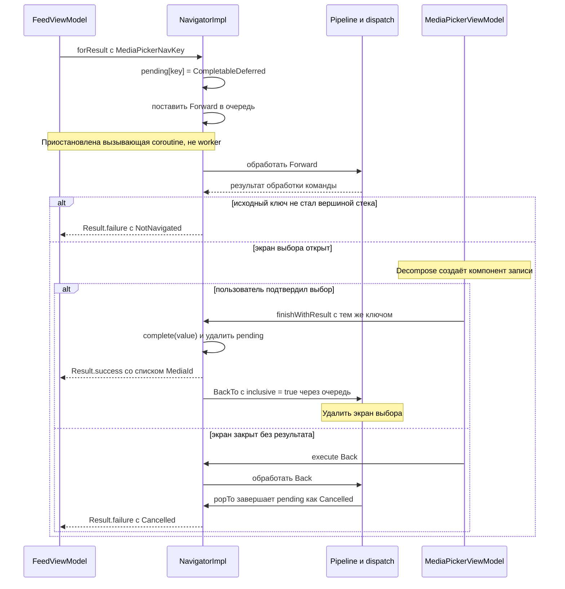
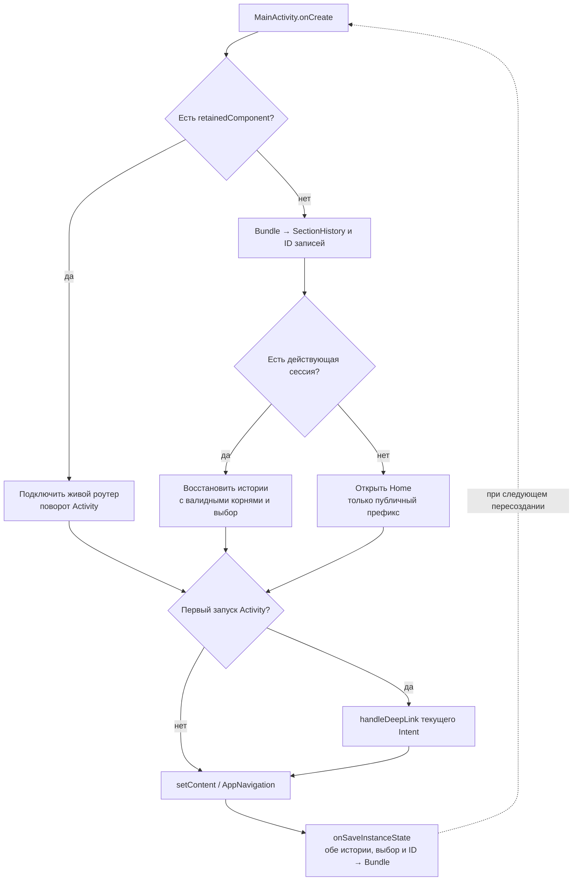
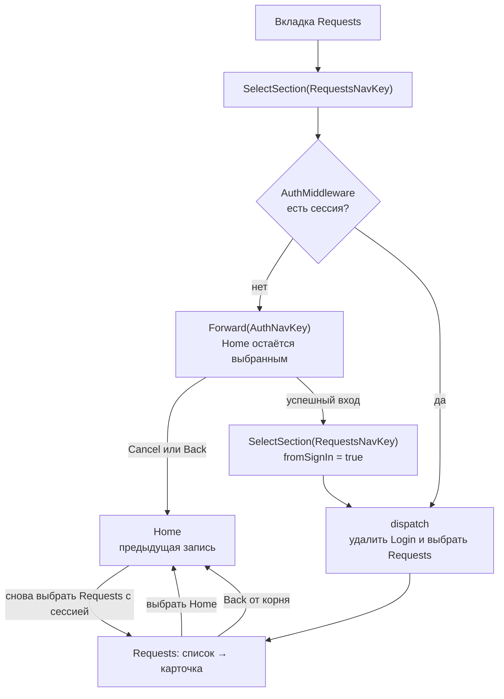

# Архитектура навигации NavPlayground в decompose/manual

Ветка `decompose/manual` переиспользует команды, очередь, middleware и экраны `main`.
Decompose получает следующее состояние обеих историй и управляет дочерними компонентами.

## 1. От действия пользователя до экрана

Стрелки показывают поток выполнения и данных, а не Gradle-зависимости.
`feature:api` хранит NavKey. В `feature:impl` находятся экраны, навигационные вклады и ViewModel, если она нужна фиче.
Фичи используют интерфейс Navigator из core и API ключей других фич, без зависимости от чужих impl.
`app` объединяет фичи, владеет навигатором и создаёт Decompose-роутер для Android-хоста.

`execute()` сразу ставит Request в неограниченный Channel и возвращается. Worker обрабатывает
команды по одной. Экраны отправляют намерения через Navigator.
Pipeline находится в core, но terminal-функция `dispatch` передаётся из NavigatorImpl в app.
Обработанные команды публикуют через `dispatch` следующее состояние двух историй одним событием.
Decompose вычисляет разницу и обновляет дочерние компоненты.

NavEntryContributor регистрирует сопоставление типа ключа с экраном в `ScreenRegistry`.
Неизвестный ключ даёт UnknownDestinationScreen через fallback, а не ошибку поиска entry.
Способ собрать contributors различается между DI-вариантами: [атлас DI](di/README.md).
AppContainer явно собирает вклады экранов, сериализаторов, обработчиков ссылок и middleware.

## 2. Middleware: порядок, остановка и подмена команды

NavigationPipeline сортирует middleware по `order`, затем строит вложенную цепочку через foldRight.
На схеме показан путь команды внутрь цепочки; код после `proceed()` выполняется в обратном порядке.
Порядок регистрации или обхода Set не используется. У элементов с одинаковым order нет гарантированного
порядка между собой.

Middleware может передать исходную команду, передать изменённую либо не вызвать `proceed()`.
FeatureFlagMiddleware подменяет цель на StubNavKey, AuthMiddleware — на AuthNavKey с returnTo.
Forward/Replace/NewRoot сохраняют тип команды. При подмене цели SelectSection получается Forward:
вход или заглушка остаются в текущем разделе, пока переключение недоступно. Аналитика видит итоговую цель.
Обычная ошибка обработки логируется на уровне Request; CancellationException распространяется дальше.

| Команда после middleware | Что делает dispatch |
|---|---|
| Forward | Добавляет ключ в активную историю. Для ключа корня выбирает раздел |
| Replace | Заменяет верхнюю запись поверх корня. Для ключа корня выбирает раздел |
| NewRoot | Сбрасывает целевую историю до указанного корня |
| SelectSection | Переключает историю. Повторный выбор удаляет записи над корнем |
| Logout | Завершает сессию, очищает историю Requests и возвращает к Feed |
| Back | Убирает верхнюю запись. От корня Requests ведёт к Home, от корня Home — в систему |
| BackTo | Находит ближайший с конца равный ключ. Для Feed операция применяется к истории Home |
| DeepLink | Только логирует неразрешённую ссылку: штатно Resolution уже должен превратить её в Forward |

BackTo с inclusive удаляет и целевой ключ. Команда игнорируется, если ключ отсутствует
или операция оставила бы стек пустым.
При удалении записей `popTo` завершает связанные ожидания результатов ошибкой Cancelled.

## 3. Пример: внешний deep link и авторизация

DeepLinkResolver сопоставляет URI с шаблонами DeepLinkHandler и строит NavKey из аргументов.
После Resolution обработка продолжается дальше по той же цепочке — без повторного старта с Logging.
Новый Replace после входа, напротив, является новой командой и проходит pipeline с начала.
Replace убирает экран входа, поэтому он не остаётся под целевым профилем.

Для External разрешена схема `navplay`; handler должен существовать и быть exported.
Internal пропускает внешнюю валидацию, но всё равно проходит Resolution, флаги и auth.
При совпадающих шаблонах resolver выбирает первый подошедший handler; это не механизм приоритета
между фичами — конфликтующие шаблоны лучше не регистрировать.

## 4. Типизированный результат между экранами

MediaPickerNavKey реализует ResultKey для списка MediaId. Тот же экземпляр/равный ключ передаётся
в экран и в finishWithResult. Результат завершается **до** постановки BackTo в очередь,
иначе удаление записи считалось бы отменой ожидания.

AlreadyPending возвращается при повторном ожидании точно равного ключа. Если middleware остановил
Forward или заменил его цель, после обработки Request навигатор выдаёт NotNavigated.
Отмена вызывающей coroutine удаляет ожидание из pending; это не закрывает открытый экран автоматически.
Pending и CompletableDeferred живут в памяти и не восстанавливаются после смерти процесса.

## 5. Восстановление историй и время жизни состояния

При повороте `retainedComponent` сохраняет Decompose-роутер. При уничтожении Activity навигатор
отсоединяет роутер и держит снимок без Android-хоста. При смерти процесса новый навигатор проверяет
корни и сессию до создания компонентов. Старый Bundle с одним стеком читается как история Home.

| Состояние | Владелец и механизм |
|---|---|
| Ключи обоих стеков, выбор и ID | DecomposeRouter. BackStackCodec сериализует ключи, Activity сохраняет снимок в Bundle |
| Compose saveable state записи | SaveableStateHolder по ID записи. Имя, выбор и прокрутка регистрируются внутри её реестра |
| ViewModel записи | ViewModelStore в InstanceKeeper дочернего компонента и ManualViewModelFactory |
| Сессия, flags, лог | Общие зависимости приложения; в playground хранятся в памяти |
| Ожидание forResult | pending внутри NavigatorImpl; только память текущего процесса |

Навигационный снимок содержит маршруты, Compose сохраняет состояние экранов отдельно.
При смерти процесса ViewModel создаются заново, сессия в памяти пропадает, ожидания результатов прекращаются.
При гостевом восстановлении Home обрезается на первой защищённой записи. Её потомки могут зависеть от её контекста.
Requests отбрасывается целиком. Эту проверку выполняет `createRouter` перед запуском Decompose.
`onNewIntent` ставит новую ссылку в очередь команд. При восстановлении Activity прежний Intent не проигрывается.

## 6. Независимые разделы и защищённый вход

В гостевом режиме доступны Feed и MediaPicker, если его флаг включён. Оба ключа Requests защищены.
Вход хранит исходную цель и тип операции. Успешный вход убирает Login с исходного стека перед выбором
Requests, поэтому Back из списка возвращает на предыдущий экран Home.
Logout очищает Requests даже при выбранном Home. Это предотвращает показ карточки прошлой сессии после нового входа.

`DecomposeRouter` использует Generic Navigation, поскольку история Requests у гостя пуста.
Только видимая запись получает состояние `RESUMED`. Остальные остаются `CREATED` и удерживают
ViewModel. Выход удаляет закрытые записи и выбирает Home одним обновлением.

Анимация читает проекцию `ChildStack`. Для Requests она содержит Home и Requests, чтобы жест Back
с корня мог показать предыдущий экран Home. Для Home проекция содержит только его историю,
поэтому на корне Back обрабатывает Android. Завершённый жест ставит Back в ту же очередь команд.
Обычные переходы используют crossfade 700 мс. ID записи различает одинаковые маршруты и связывает
сохранённый UI со стеком при восстановлении. [Generic Navigation](https://arkivanov.github.io/Decompose/navigation/children/overview/) ·
[AndroidX ViewModel](https://arkivanov.github.io/Decompose/tips-tricks/composable-viewmodel/)

Экраны списка и карточки читают один локальный набор данных. В ключе карточки передаётся только ID.
Сценарий проверяет навигацию без отдельной ViewModel для статических данных.

## Исходники и проверки

- [Контракт Navigator и ошибки результатов](../core/navigation/src/main/kotlin/dev/navplay/core/navigation/Navigator.kt)
- [Команды и работа с целевым ключом](../core/navigation/src/main/kotlin/dev/navplay/core/navigation/NavigationCommand.kt)
- [NavigatorImpl: очередь, pending, dispatch и startup hooks](../app/src/main/kotlin/dev/navplay/app/navigation/NavigatorImpl.kt)
- [NavigationPipeline](../core/navigation/src/main/kotlin/dev/navplay/core/navigation/NavigationPipeline.kt)
- [DeepLinkResolver и UriPattern](../core/navigation/src/main/kotlin/dev/navplay/core/navigation/DeepLink.kt)
- [AuthMiddleware](../feature/auth/impl/src/main/kotlin/dev/navplay/feature/auth/impl/AuthMiddleware.kt)
- [BackStackCodec](../core/navigation/src/main/kotlin/dev/navplay/core/navigation/NavKeySerializers.kt)
- [DecomposeRouter и дочерние компоненты](../app/src/main/kotlin/dev/navplay/app/navigation/DecomposeRouter.kt)
- [AppNavigation и сохранение Compose-состояния](../app/src/main/kotlin/dev/navplay/app/navigation/AppNavigation.kt)
- [MainActivity: Intent и сохранение состояния](../app/src/main/kotlin/dev/navplay/app/MainActivity.kt)
- [NavigatorImplTest](../app/src/test/kotlin/dev/navplay/app/navigation/NavigatorImplTest.kt)
- [NavigationPipelineTest](../core/navigation/src/test/kotlin/dev/navplay/core/navigation/NavigationPipelineTest.kt)
- [BackStackCodecTest](../core/navigation/src/test/kotlin/dev/navplay/core/navigation/BackStackCodecTest.kt)

Ссылки открывают код текущей ветки. Способ создания объектов сравнивается в [атласе DI](di/README.md),
статус проверок проекта — в [WORK_CONTEXT.md](WORK_CONTEXT.md).
