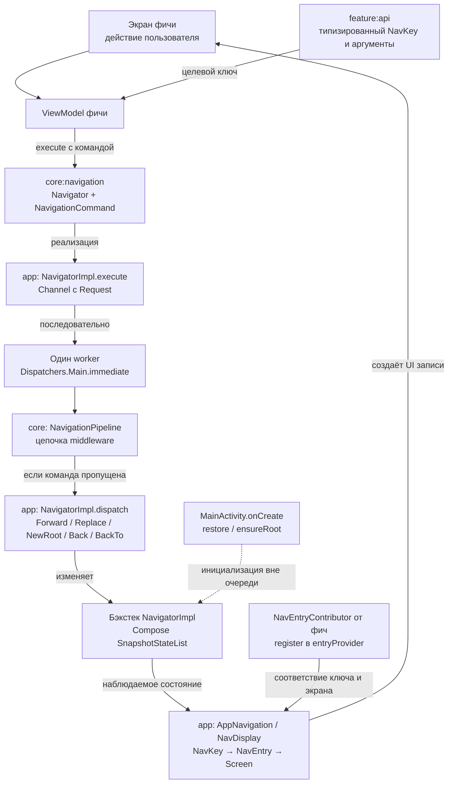
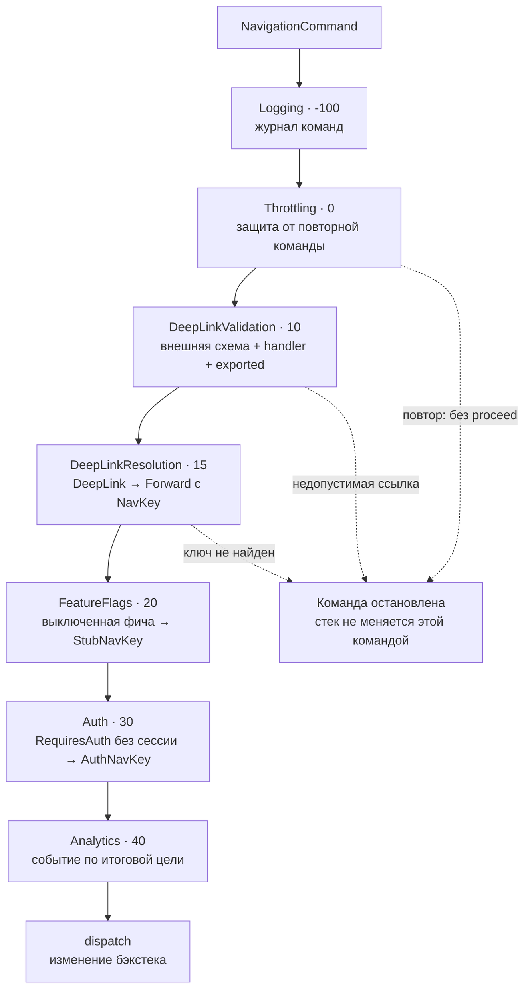
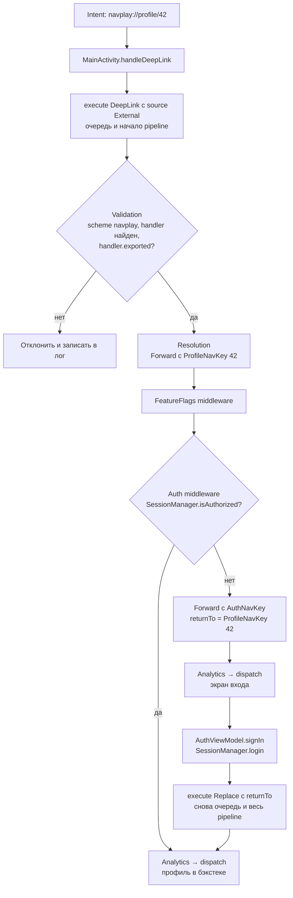
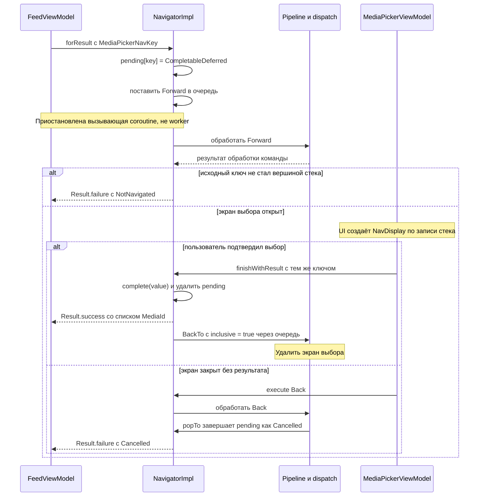
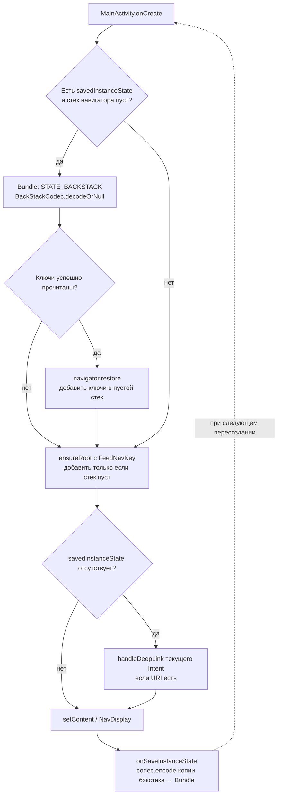

# Архитектура навигации NavPlayground

Навигация одинакова в `main` (manual DI), `di/hilt`, `di/koin` и `di/metro`.
DI определяет способ создания объектов; контракты, очередь, middleware и операции со стеком общие.
Схемы отражают исходники; UI-поведение на устройстве пока отдельно не проверялось.

## 1. От действия пользователя до экрана

Стрелки показывают поток выполнения и данных, а не Gradle-зависимости.
`feature:api` хранит NavKey; `feature:impl` — экран, ViewModel и навигационные вклады.
Фичи используют интерфейс Navigator из core и API ключей других фич, без зависимости от чужих impl.
`app` объединяет фичи, владеет реализацией навигатора и отображает стек через Navigation 3.

`execute()` сразу ставит Request в неограниченный Channel и возвращается. Worker обрабатывает
команды по одной: экран не вызывает NavDisplay или изменение списка напрямую.
Pipeline находится в core, но terminal-функция `dispatch` передаётся из NavigatorImpl в app.
Обработанные команды меняют стек через dispatch; `restore` и `ensureRoot` — отдельные startup hooks.

NavEntryContributor регистрирует сопоставление типа ключа с экраном.
Неизвестный ключ даёт UnknownDestinationScreen через fallback, а не ошибку поиска entry.
Способ собрать contributors различается между DI-вариантами: [атлас DI](di/README.md).
Для manual/Koin одного подключения Gradle-модуля недостаточно — регистрации добавляются явно.

## 2. Middleware: порядок, остановка и подмена команды

NavigationPipeline сортирует middleware по `order`, затем строит вложенную цепочку через foldRight.
На схеме показан путь команды внутрь цепочки; код после `proceed()` выполняется в обратном порядке.
Порядок регистрации или обхода Set не используется. У элементов с одинаковым order нет гарантированного
порядка между собой.

Middleware может передать исходную команду, передать изменённую либо не вызвать `proceed()`.
FeatureFlagMiddleware подменяет целевой ключ на StubNavKey, AuthMiddleware — на AuthNavKey с returnTo;
тип Forward/Replace/NewRoot сохраняется. Аналитика видит уже изменённую цель.
Обычная ошибка обработки логируется на уровне Request; CancellationException распространяется дальше.

| Команда после middleware | Что делает dispatch |
|---|---|
| Forward | Добавляет ключ наверх |
| Replace | Удаляет верхний ключ, затем добавляет новый |
| NewRoot | Удаляет все записи и добавляет новый корень |
| Back | Удаляет верхнюю запись, если она не последняя |
| BackTo | Находит ближайший с конца равный ключ; inclusive удаляет и его |
| DeepLink | Только логирует неразрешённую ссылку: штатно Resolution уже должен превратить её в Forward |

BackTo игнорируется, если ключ не найден или операция оставила бы стек пустым.
При удалении записей `popTo` завершает связанные ожидания результатов ошибкой Cancelled.

## 3. Пример: внешний deep link и авторизация

DeepLinkResolver сопоставляет URI с шаблонами DeepLinkHandler и строит NavKey из аргументов.
После Resolution обработка продолжается дальше по той же цепочке — без повторного старта с Logging.
Новый Replace после входа, напротив, является новой командой и проходит pipeline с начала.
Replace убирает экран входа, поэтому он не остаётся под целевым профилем.

Для External разрешена схема `navplay`; handler должен существовать и быть exported.
Internal пропускает внешнюю валидацию, но всё равно проходит Resolution, флаги и auth.
При совпадающих шаблонах resolver выбирает первый подошедший handler; это не механизм приоритета
между фичами — конфликтующие шаблоны лучше не регистрировать.

## 4. Типизированный результат между экранами

MediaPickerNavKey реализует ResultKey для списка MediaId. Тот же экземпляр/равный ключ передаётся
в экран и в finishWithResult. Результат завершается **до** постановки BackTo в очередь,
иначе удаление записи считалось бы отменой ожидания.

AlreadyPending возвращается при повторном ожидании точно равного ключа. Если middleware остановил
Forward или заменил его цель, после обработки Request навигатор выдаёт NotNavigated.
Отмена вызывающей coroutine удаляет ожидание из pending; это не закрывает открытый экран автоматически.
Pending и CompletableDeferred живут в памяти и не восстанавливаются после смерти процесса.

## 5. Восстановление стека и время жизни состояния

При повороте process-level навигатор уже хранит стек: восстановление не перезаписывает его.
После смерти процесса создаётся новый пустой навигатор; Activity пытается восстановить список ключей.
Повреждённый JSON или неизвестный сериализатор дают null; ensureRoot обеспечивает стартовый Feed.
Кодирование ключей выполняется через объединённые NavKeySerializers всех фич и app-заглушки.

| Состояние | Владелец и механизм |
|---|---|
| Список ключей экранов | NavigatorImpl; сохраняется BackStackCodec в Bundle |
| Compose saveable state записи | rememberSaveableStateHolderNavEntryDecorator |
| ViewModel записи | rememberViewModelStoreNavEntryDecorator и фабрика выбранного DI |
| Сессия, flags, лог | Общие зависимости приложения; в playground хранятся в памяти |
| Ожидание forResult | pending внутри NavigatorImpl; только память текущего процесса |

Восстановление ключей не восстанавливает объекты ViewModel, авторизованную сессию или незавершённые
ожидания результатов. Restore не прогоняет восстановленные ключи через middleware.
Внешний Intent при пересоздании с savedInstanceState повторно не обрабатывается;
`onNewIntent` передаёт новую ссылку в ту же очередь команд.

## Исходники и проверки

- [Контракт Navigator и ошибки результатов](../core/navigation/src/main/kotlin/dev/navplay/core/navigation/Navigator.kt)
- [Команды и работа с целевым ключом](../core/navigation/src/main/kotlin/dev/navplay/core/navigation/NavigationCommand.kt)
- [NavigatorImpl: очередь, pending, dispatch и startup hooks](../app/src/main/kotlin/dev/navplay/app/navigation/NavigatorImpl.kt)
- [NavigationPipeline](../core/navigation/src/main/kotlin/dev/navplay/core/navigation/NavigationPipeline.kt)
- [DeepLinkResolver и UriPattern](../core/navigation/src/main/kotlin/dev/navplay/core/navigation/DeepLink.kt)
- [AuthMiddleware](../feature/auth/impl/src/main/kotlin/dev/navplay/feature/auth/impl/AuthMiddleware.kt)
- [BackStackCodec](../core/navigation/src/main/kotlin/dev/navplay/core/navigation/NavKeySerializers.kt)
- [AppNavigation и декораторы записей](../app/src/main/kotlin/dev/navplay/app/navigation/AppNavigation.kt)
- [MainActivity: Intent и сохранение состояния](../app/src/main/kotlin/dev/navplay/app/MainActivity.kt)
- [NavigatorImplTest](../app/src/test/kotlin/dev/navplay/app/navigation/NavigatorImplTest.kt)
- [NavigationPipelineTest](../core/navigation/src/test/kotlin/dev/navplay/core/navigation/NavigationPipelineTest.kt)
- [BackStackCodecTest](../core/navigation/src/test/kotlin/dev/navplay/core/navigation/BackStackCodecTest.kt)

Ссылки открывают код текущей ветки. Способ создания объектов сравнивается в [атласе DI](di/README.md),
статус проверок проекта — в [WORK_CONTEXT.md](WORK_CONTEXT.md).
